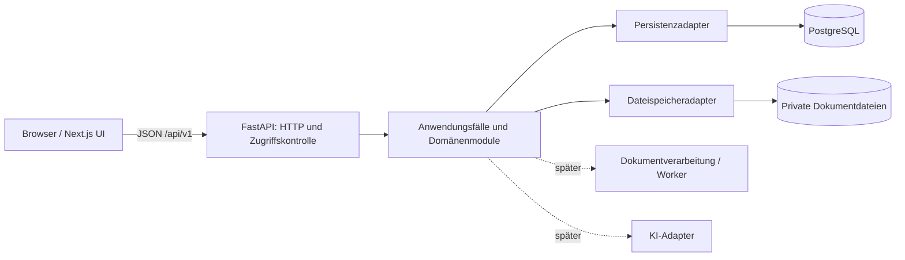
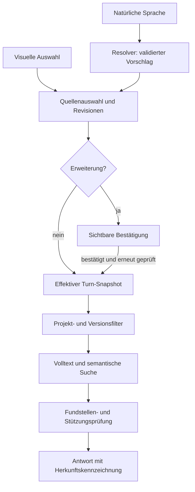

# Systemarchitektur

Status: Zielarchitektur mit erstem lokalem Backend-Vertikalschnitt, Stand 16. November 2026.
Anforderungen und offene Annahmen: [REQUIREMENTS](docs/REQUIREMENTS.md).
Persistenzdetails: [DATA_MODEL](docs/DATA_MODEL.md).
Verbindlicher Quellenvertrag: [SOURCE_MANAGEMENT](docs/SOURCE_MANAGEMENT.md).

## Zielbild und Systemgrenzen

Ein Monorepository enthält eine Next.js-Anwendung und einen modularen
FastAPI-Monolithen. Beide sind getrennte Prozesse; nur das Backend greift auf
PostgreSQL und Dokumentdateien zu. Das reduziert Betriebsaufwand und ermöglicht
transaktionale Fachoperationen, ohne spätere Modulgrenzen aufzugeben.



Ein Reverse Proxy führt Browser und API im Produktbetrieb unter demselben Ursprung
zusammen. Authentifizierung wird in Phase 1 serverseitig geprüft. Next.js kann für
Rendering die API nutzen, enthält aber keine zweite Geschäftslogik oder eigene
SQL-Zugriffe. CORS ist in der Entwicklung auf bekannte Ursprünge beschränkt.

## Struktur und Implementierungsstand

`apps/api` ist vorhanden: FastAPI-Adapter, PostgreSQL-Modelle, Alembic-Migrationen,
Quellenpipeline und `knowledge`-Anwendungsfälle einschließlich Tests. `apps/web`,
vollständiger Katalog und eine Chat-Oberfläche sind noch nicht implementiert. Ein kleines Modulmodell
und die quellenkontrollierte Recherche sind vorhanden, kein vollständiges Study-Modul.
Der aktuelle Schnitt ist in [KNOWLEDGE_LINKING](docs/KNOWLEDGE_LINKING.md) beschrieben.
Die folgende Struktur enthält auch diese noch geplanten Module:

```text
apps/web/                     Next.js, TypeScript, Komponenten und API-Client
apps/api/app/
  api/                        FastAPI-Routen, DTOs, Fehlerabbildung, Authentifizierung
  modules/
    projects/                 Eigentümerschaft und Projektkontext
    study/                    Module und Themen
    sources/                  Gemeinsamer Quellenkern für Study und Research
    knowledge/                Themen-/Aufgabenbezüge und manuelle Review-Anwendungsfälle
    retrieval/                Scope, Volltextsuche, Citation-Prüfung und Tutor-Kontext
    tutor/                    Deterministischer Ablauf, Kontextbudget, Provider und Symbolik
  infrastructure/             SQLAlchemy, Dateispeicher, Konfiguration
apps/api/migrations/          Alembic-Migrationen
apps/api/tests/               Domänen-, API- und PostgreSQL-Integrationstests
docs/                         Architektur, Verträge, Entscheidungen
```

Innerhalb eines Moduls werden reine Domänenregeln, Anwendungsfälle und Adapter
getrennt. Anwendungsfälle koordinieren Transaktionen und prüfen Invarianten;
HTTP-Routen validieren Eingaben und delegieren. Module sprechen über kleine
öffentliche Anwendungsfunktionen. Kein generisches Pluginframework, kein Bus
und keine abstrakte Repositoryhierarchie ohne konkreten Bedarf. Ports entstehen
zuerst an tatsächlich variablen Grenzen: Dateien, später KI und Extraktion.

## Technische Entscheidungen

| Entscheidung | Begründung und Konsequenz |
| --- | --- |
| Next.js + TypeScript | Strukturierte Weboberfläche und typisierte Interaktion; kein eigener Fachserver in Next.js. |
| FastAPI + Pydantic | Python-Ökosystem für Mathematik und Verarbeitung; explizite validierte API-Verträge. |
| PostgreSQL + SQLAlchemy + Alembic | Beziehungen, Integrität und transaktionale Änderungen; Migrationen ab dem ersten Schema. SQLite ersetzt keine Integrationstests. |
| REST unter `/api/v1`, OpenAPI | Nachvollziehbarer Vertrag und später generierbarer TS-Client; GraphQL ist zunächst unnötig. |
| Relationale Kernfelder, begrenztes JSONB | IDs und Beziehungen bleiben prüfbar. JSONB nur für versionierte bibliografische Zusatzdaten oder typspezifische Locatorfelder. |
| Private Dateien außerhalb der DB | Lokales persistentes Verzeichnis im Entwicklungsbetrieb; austauschbarer Storageadapter für späteren Objektspeicher. Metadaten und Hash in PostgreSQL. |
| Unveränderliche Dokumentversionen | Alte Belege bleiben nachvollziehbar; Mehrbedarf an Speicher und explizite Löschregeln. |
| Gemeinsame serverseitige Quellensteuerung | UI und Chat nutzen dieselbe Auswahlrevision; KI-Anbieter können keine Berechtigungen erweitern. |
| Volltext und pgvector ab Phase 2b | Beide Suchpfade sind für die hybride Suche erforderlich; Ranking erfolgt ausschließlich innerhalb der freigegebenen Versionsmenge. |
| Kein pgvector, OCR oder KI-SDK in Phase 1 | Zuerst belastbare Quellen und Fundstellen; Retrieval benötigt später Qualitätsnachweise. |
| SymPy/NumPy erst bei Rechenanwendungsfällen | Vermeidet ungenutzte Abhängigkeiten. Ausführung fremder Formeln braucht später Ressourcenlimits und Isolation. |

Exakte Runtime- und Paketversionen werden mit Phase 1 auf unterstützte,
kompatible Versionen festgelegt und gelockt. Es werden jetzt keine ungetesteten
Versionskombinationen als verbindlich ausgegeben.

Der spätere Retrieval-Auftrag präzisiert den aktuellen Schnitt: PostgreSQL-Volltext
ist implementiert; Semantik ist optional und über einen lokalen Embedding-Port
testbar. Es wurden weder pgvector noch ein reales Modell installiert. Die frühere
pgvector-Planung beschreibt weiterhin die mögliche große Hybrid-Ausbaustufe, keine
Voraussetzung dieses Backends. [RETRIEVAL](docs/RETRIEVAL.md) dokumentiert den
verbindlichen aktuellen Vertrag und seine Grenzen. Python-/Paketversionen stehen
in apps/api/.python-version und uv.lock.

Die additive Migration 0003 ergänzt Module/ModuleDocument sowie RetrievalScope
und RetrievalScopeItem. Der Scope pinnt vorhandene Dokumentversionen und ihre
Analyseläufe; ein materialisiertes SQL-Teilergebnis begrenzt die Segmente vor Suche
und Ranking. Citation-Prüfung verwendet gespeicherten Seitentext und Originalhash,
keine LLM-Ausgabe. Bestätigte Themen-/Voraussetzungsbelege werden erst danach ergänzt.
Es gibt keine zweite Dokumentpipeline und keine Änderung manueller Prüfentscheidungen.

Die Tutor-Phase ergänzt [PhysicsTutorService](docs/PHYSICS_TUTOR.md) mit vier Modi.
Er verwendet ausschließlich die vorhandene Retrieval-/Citation-Engine; versionierte
Prompts und Provideradapter enthalten keine Datenbank- oder Auswahlregeln. Ganze
Passagen werden mit konservativem Byte-/Tokenproxy begrenzt. Die additive Migration
0004 speichert Conversation, Turn, Quellen-/Analysekontext, Fehlerstatus und erlaubte
Metadaten. Modellawait und Mathematik laufen außerhalb der Projekttransaktion;
Quellen werden davor und danach erneut geprüft. Symbolik nutzt eine kleine AST-
Sprache im zeitbegrenzten Prozess, keine vom Modell erzeugte Python-Ausführung.
Standard ist ein transparenter Mock; der HTTPS-Adapter braucht explizite Konfiguration
und Versandfreigabe. Strukturprüfung von Citations ist keine semantische Belegprüfung.

## Gemeinsamer Quellenkern

`sources` stellt Katalog, Versionsverwaltung und manuell geprüfte Fundstellen bereit;
mit Phase 2 kommen Auswahlregeln, Suche und später automatisierte Prüfverfahren hinzu.
`study` und später `research`
verwenden dieselben Anwendungsfälle. Unterhaltungen gehören zu einem Projekt,
benötigen aber kein Studienmodul. Der Tutor orchestriert Antworten über diese
Grenze und einen austauschbaren KI-Port, ohne Auswahlregeln in Prompts auszulagern.



Der Resolver kann Regeln oder KI verwenden, autorisiert aber nichts. Gruppen und
Kategorien werden auf konkrete Versionen aufgelöst. Einschränkungen wirken ohne
Erweiterungsbestätigung; Hinzunahmen warten auf eine sichtbare Benutzeraktion.
Alle Inhaltsabrufe, Cachetreffer und Folgeturn-Kontexte respektieren den effektiven
Scope. Quellenzugriff und Zustimmung zum externen KI-Versand bleiben getrennt.
Geprüfte Fundstellen und deren Stützung einer konkreten Aussage sind getrennte
Eigenschaften; Ausgabe erfolgt als quellenbelegt, Eigenableitung oder Modellwissen.
Einzelheiten, Konfliktregeln und Testfälle stehen im Quellenvertrag.

## API und Konsistenz

Phase 1 umfasst projektgebundene Ressourcen, etwa
`/api/v1/projects/{project_id}/modules` und entsprechende Endpunkte für Dokumente,
Versionen, Themen und Quellenverweise. Schreib-DTOs erlauben nur explizite Felder.
Listen werden paginiert und stabil nach Zeitstempel und ID sortiert.
Fehler liefern maschinenlesbaren Code, lesbare Nachricht und Request-ID; niemals
Stacktraces oder Dokumentinhalte. Fremde Ressourcen werden konsistent als nicht
verfügbar behandelt, ohne ihre Existenz offenzulegen.

Eine Fachoperation verwendet eine DB-Transaktion. Datei und DB bilden keine gemeinsame
Transaktion: Upload zunächst privat temporär speichern, Typ/Größe/Hash prüfen,
danach Metadaten anlegen und atomar in den endgültigen Speicher verschieben.
Ein Status `pending → ready | failed` verhindert Abruf unvollständiger Dateien;
Wiederholung und Bereinigung verwaister Dateien müssen getestet werden. Downloads
prüfen Berechtigung und Status erneut. Originalnamen werden nie als Speicherpfad benutzt.

Konkurrierende Prüfentscheidungen verwenden bereits eine erwartete Revision und
serialisierte Projekttransaktionen; veraltete Updates liefern 409.
Im übrigen Zielsystem verwenden Metadatenänderungen einen Revisionszähler mit bedingtem
Update; veraltete Schreibversuche liefern 409. Dokumentversionen werden nicht
überschrieben. Harte Löschung wird blockiert, solange Quellenverweise existieren.

## Sicherheit, Betrieb und Tests

Phase 1 setzt eine private Einzelbenutzerinstallation voraus; ein expliziter lokaler
Entwicklungsmodus darf einen Testbenutzer injizieren, niemals im öffentlich erreichbaren
Betrieb. Vor öffentlicher Bereitstellung sind Session-Authentifizierung über einen
bewährten OIDC-Anbieter, CSRF-Schutz für Cookie-Schreibzugriffe und sichere Cookies
Pflicht. Die konkrete Anbieterwahl bleibt offen und blockiert keinen lokalen Prototyp.

Dateityp, Signatur und Größe prüfen; Phase 1 akzeptiert nur PDFs, rendert keine
hochgeladenen HTML-Dateien und führt keine Inhalte aus. Downloads als Attachment
mit `nosniff`; eine spätere PDF-Vorschau benötigt eigene Sicherheitsprüfung.
URLs sind zunächst Metadaten, kein serverseitiger Abruf (SSRF vermeiden).
Logs enthalten IDs, Laufzeiten und Fehlerklassen statt Dokumenttext oder Secrets.
Migrationen, Datenbank und Dateispeicher benötigen gemeinsam getestete Backups
vor produktiver Nutzung; zulässige Dateigrößen und Aufbewahrung werden konfiguriert.

Bereits umgesetzt sind reine Pipeline-Tests, PostgreSQL-/API-Integrationstests und
Migrationen. Eine lokale Entwickleridentität ist nur im expliziten lokalen Modus
verfügbar; produktive Authentifizierung fehlt. Der Parser arbeitet synchron mit
Größen-/Seitenlimits; allgemeine OCR und eine Sandbox sind nicht implementiert.

Ziel für den vollständigen Study Workspace: reine Domänenregeln, PostgreSQL-Constraints und Transaktionen,
API-Zugriffskontrolle, Dateifehlerfälle und ein durchgängiger Browserworkflow.
KI- und externe Netzwerkaufrufe sind nie Voraussetzung der Kern-Tests.
Die Backend-CI führt Ruff und die Tests mit PostgreSQL und eingefrorenen Abhängigkeiten
aus. Frontend-Typprüfung und Web-Build folgen erst mit dem Frontend.
