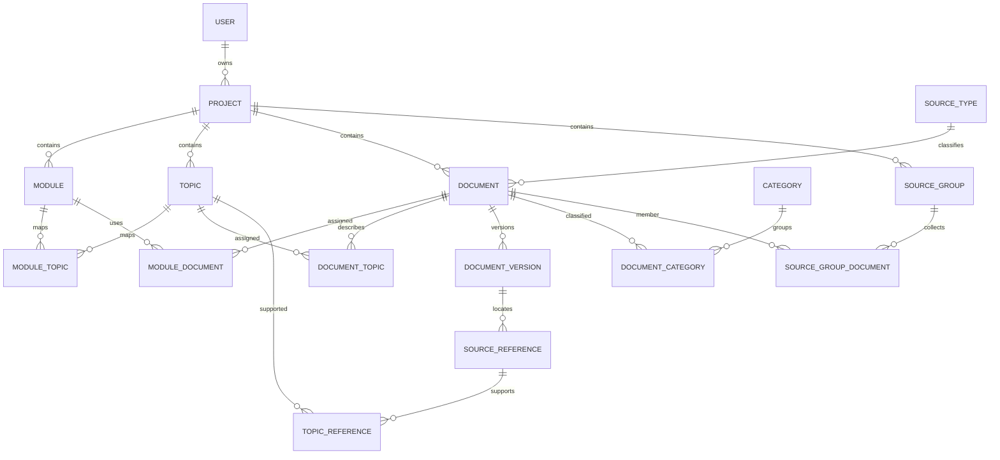

# Datenmodell

Das folgende Gesamtmodell ist ein relationaler Entwurf. Ein begrenzter Teil ist
inzwischen implementiert und migriert; die Abbildung steht im nächsten Abschnitt.
Tabellen verwenden
UUID-Primärschlüssel und `timestamptz` für Zeitpunkte. Veränderliche Entitäten
erhalten `created_at`, `updated_at` und einen Revisionszähler. Pflichtfelder sind
unten ohne `?` aufgeführt. Fremdschlüssel und fachliche Uniqueness werden in der
Datenbank abgesichert; Inhaltsvalidierung erfolgt zusätzlich im Backend.

## Implementierter Vertikalschnitt

Maßgeblich für das laufende Backend sind die [SQLAlchemy-Modelle](../apps/api/app/infrastructure/models.py)
und die versionierten [Migrationen](../apps/api/migrations/versions).
Das allgemeine Modell unten wird damit noch nicht vollständig umgesetzt.

| Modell | Aktuell gespeicherte Struktur |
| --- | --- |
| Project / Topic | Entwickler-Eigentümerkennung, Projekttitel; Themen mit Namen und expliziten Aliassen. Keine separate Benutzertabelle. |
| Module / ModuleDocument | Minimales Projektmodul und N:m-Dokumentzuordnung mit projektgebundenen Fremdschlüsseln. |
| RetrievalScope / RetrievalScopeItem | Revisionierte explizite Quellenauswahl; konkrete Dokumentversionen und Analyseläufe werden gepinnt. Keine automatische Aktivierung neuer Stände. |
| Document / DocumentVersion | Titel, wissenschaftlicher Quellentyp; unveränderliche Originaldatei mit SHA-256 und Seitenzahl. Umfangreiche bibliografische Metadaten folgen später. |
| AnalysisRun | Originalversion, Extraktor-/Analyzerversion, Konfigurationshash, Warnungen und Ergebnis-IDs sowie unveränderte extrahierte Seitentexte. |
| DocumentSegment | Dokumentversion, Ursprungslauf, physische Seite, exakter Text und halb-offene Zeichenoffsets sowie Qualitätswarnungen. Grundlage der späteren Passage-Verarbeitung, kein zusätzlicher Suchindex. |
| Exercise / ExerciseSegment | Erkanntes Aufgabenlabel und zugehörige Segmente derselben Version; entspricht dem Herkunftsteil der späteren Task-Entität. Keine Versuche oder Lernfortschrittsdaten. |
| TopicRelation | Gerichtete Voraussetzung oder symmetrische Verwandtschaft zwischen Themen; Begründung, Herkunft, unkalibrierter Indikator, Prüfstatus und Revision. |
| SourceLink | Segment oder Aufgabe zu Thema; EXPLAINS/APPLIES/EXAMINES/RELATED_TO mit derselben Provenienz und Reviewsemantik. |
| LinkEvidence | Konkretes Zitat mit Segment-/Seitenrückbindung und Offsets; getrennt extracted/uncertain/manually_checked, Analyseherkunft oder manueller Akteur. |
| ReviewDecision | Persistentes Audit von Annahme, Ablehnung oder Korrektur mit Akteur, Begründung, Revision und expliziter Belegprüfbestätigung. |
| TutorConversation | Projekt-/Eigentümerbindung und ein fester RetrievalScope für die Unterhaltung. |
| TutorTurn | Eindeutige Request-ID und Reihenfolge; Frage, Modus, Tiefe, konkrete Scope-Revision/Filter, budgetierter Kontext, Prompt-/Modellmetadaten, Tools, Antwort oder sicherer Fehlerstatus. |

Segment- und Aufgabenidentitäten binden Inhalt, Position bzw. vollständige
Segmentzuordnung. SourceLinks und TopicRelations haben eindeutige fachliche
Endpunkte pro Projekt. Korrekturen erzeugen neue Vorschläge mit `corrected_from_id`;
das Original bleibt abgelehnt erhalten. Neue Belege dürfen nur noch ungeprüfte
Vorschläge mit Revisionsänderung ergänzen. Bereits getroffene Entscheidungen werden
von einer erneuten Analyse nicht überschrieben. Projektgebundene Fremdschlüssel
verhindern fremde Endpunkte und Belege auch auf Datenbankebene.

LinkEvidence ist die derzeit implementierte Belegstruktur für Beziehungen. Die
allgemeinen SourceReference-/ReferenceVerification- und Chat-Claim-Tabellen unten
sind noch nicht implementiert; ihre spätere Integration muss diese Herkunft
übernehmen, statt einen zweiten unabhängigen Belegbestand zu schaffen.
Semantik und Grenzen: [KNOWLEDGE_LINKING](KNOWLEDGE_LINKING.md).
Retrieval und Citation-Prüfung: [RETRIEVAL](RETRIEVAL.md). Die additive Migration
0003 ergänzt außerdem `DocumentSegment.chapter_label` als optionales, tatsächlich
erkanntes Überschriftenlabel. Die generischen Chat-Auswahltabellen unten sind damit
noch nicht implementiert; eine spätere Conversation soll den vorhandenen Scope
verwenden, statt konkurrierende Quellenberechtigungen zu erzeugen.
Die Tutor-API nutzt bereits `TutorConversation` und `TutorTurn` aus Migration 0004.
Diese ersetzen nicht die weiter unten geplanten granularen Claim-/Lernmodelle.
Secrets oder rohe Providerfehler werden nicht in den Turn-Metadaten gespeichert.
Unterhaltungen und Originalkontexte sind private Nutzerdaten und benötigen ein
gemeinsames Aufbewahrungs-/Löschkonzept vor produktiver Nutzung.

## Kernentitäten der Phase 1

| Entität | Wesentliche Felder | Bedeutung |
| --- | --- | --- |
| User | id, external_subject (unique) | Eigentümer; lokal fester Entwicklungsbenutzer, später Identität aus Authentifizierung. |
| Project | id, owner_id, kind, title, description? | Arbeitskontext; `kind=study` wird zunächst angeboten. `research` bleibt reserviert. |
| Module | id, project_id, title, code?, semester?, description? | Physikmodul; Modulkürzel bei Vorhandensein je Projekt eindeutig. |
| Topic | id, project_id, title, description? | Thema innerhalb eines Projekts; nicht global zusammenführen. |
| ModuleTopic | project_id, module_id, topic_id | N:m; ein Thema kann zu mehreren Modulen gehören. |
| SourceType | id, code (unique), label | Wissenschaftliche Funktion: textbook, lecture_notes, exercise_sheet, worked_solution, past_exam, paper, website, other. |
| Document | id, project_id, source_type_id, title, contributors (geordnetes JSONB-Array), semester?, document_year?, publication_year?, sheet_number?, doi?, url?, bibliographic_extra (JSONB), metadata_schema_version | Bibliografische Quelle, unabhängig von Datei und Auflage. |
| DocumentVersion | id, project_id, document_id, version_number, edition_label?, storage_key, sha256, mime_type, byte_size, page_count, status, uploaded_at | Unveränderlicher PDF-Stand; `page_count` erst ab ready zwingend. Hash bezieht sich auf gespeicherte Originalbytes. |
| ModuleDocument | project_id, module_id, document_id | N:m; eine Quelle kann mehrere Module unterstützen. |
| DocumentTopic | project_id, document_id, topic_id | N:m; Metadatenzuordnung eines Dokuments zu Themen, ohne damit schon eine Aussage zu belegen. |
| Category | id, project_id, name | Frei wählbare Einordnung; normalisierter Name je Projekt eindeutig. |
| DocumentCategory | project_id, document_id, category_id | N:m; Kategorien sind keine Quellentypen. |
| SourceGroup | id, project_id, name, description? | Benannte manuelle Sammlung von Dokumenten, etwa „Klausurvorbereitung Mechanik“. |
| SourceGroupDocument | project_id, source_group_id, document_id | N:m; Mitgliedschaft allein aktiviert keine Quelle in einer Unterhaltung. |
| SourceReference | id, project_id, document_version_id, label?, locator_schema_version, locator, quote?, verification_status (abgeleitet) | Benannte Fundstelle; `locator` ist validiertes JSONB. Anfänglich unverified oder manually_checked, abgeleitet aus den Prüfnachweisen. |
| ReferenceVerification | id, project_id, source_reference_id, source_hash, checked_content, content_fingerprint, method, verifier_id?, verifier_version?, checked_at, result | Append-only-Prüfung der tatsächlichen Text-/Formelstelle. In Phase 1 nur manuell mit Prüfer; maschinelle Verfahren erst später. |
| TopicReference | project_id, topic_id, source_reference_id | N:m-Verknüpfung von Themen mit Belegen. |

Typen beschreiben die Art einer Quelle; Kategorien sind persönliche Ordnung;
Themen beschreiben fachliche Inhalte. Eine Klausur kann beispielsweise den Typ
`past_exam`, die Kategorie „Wintersemester“ und Belege zum Thema „Drehimpuls“ haben.
Eine Datei ohne ausreichende bibliografische Angaben darf gespeichert werden;
fehlende Angaben werden angezeigt, nicht erfunden. DOI ist nicht pauschal unique:
verschiedene Projektkontexte dürfen dieselbe Publikation enthalten.

`contributors` enthält validierte Einträge mit Namen und Rollen, etwa `author`,
`lecturer` oder `editor`; ein Professor wird als Person mit passender Rolle erfasst,
nicht aus einem Titel geraten. Die Reihenfolge bleibt erhalten. `document_year`
bezeichnet beispielsweise das Klausurjahr, `publication_year` das Veröffentlichungsjahr;
der Bereichsfilter „Altklausuren 2022 bis 2024“ verwendet ausdrücklich `document_year`.
`semester` hat ein normalisiertes Terminkürzel und ein Anzeigelabel; fehlende Angaben
sind unbekannt und erfüllen keinen Jahres-/Semesterfilter. `sheet_number` bezeichnet
das Blatt, `exercise_label` im Locator die konkrete Aufgabe oder Teilaufgabe. Ein
Blatt kann viele Aufgaben enthalten. Alle diese Angaben sind optional, bleiben aber
typisiert und durchsuchbar. Studienmodule sind für Dokumente im Research-Projekt
nicht erforderlich; `project_id` ist immer Pflicht.

DOIs werden ohne URL-Präfix normalisiert und mit ihrem Originalwert aufbewahrt;
ihre syntaktische Gültigkeit bestätigt weder bibliografische Identität noch Inhalt.
Für den späteren BibTeX-Import wird `BibliographicRecord` als projektgebundener
Datensatz mit `document_id`, Format-/Parser-Version, entry_type, citation_key,
validierten Feldern und unverändertem Importtext ergänzt. Importkonflikte werden
angezeigt, nicht still überschrieben; externe Metadaten sind keine Belegverifikation.



## Präzise Fundstellen

Phase 1 unterstützt ausschließlich den Locator `pdf`, zum Beispiel:

```json
{
  "kind": "pdf",
  "page_start": 17,
  "page_end": 18,
  "printed_page_label": "12–13",
  "section": "2.3",
  "equation_label": "(2.14)",
  "exercise_label": "7b"
}
```

Physische PDF-Seiten sind **1-basiert und inklusiv**. Es gilt
`1 <= page_start <= page_end <= page_count`; PDF-Seiten sind Pflicht,
gedrucktes Label, Abschnitt, Gleichungs- und Aufgabenlabel optional. Ein Zitat ist optionaler,
manuell erfasster Text und kein Beweis dafür, dass es geprüft wurde.
Die API liefert Versions-ID, Hash und Locator gemeinsam, damit Belege auflösbar sind.
Externe URLs ohne gespeicherten Stand erhalten in Phase 1 keinen scheinbar
präzisen Quellenverweis. Später kommen eigene validierte Locatorvarianten für
Web-Snapshots, Textbereiche und LaTeX-Labels hinzu; keine untypisierten Freitextanker.

Ein Quellenverweis bleibt bezüglich Version, Locator und Zitat unveränderlich.
Korrekturen erzeugen einen neuen Verweis; Anzeigeattribute dürfen aktualisiert
werden. Neue Prüfergebnisse werden als ReferenceVerification angehängt; der aktuelle
Prüfstatus wird daraus abgeleitet, historische Nachweise bleiben erhalten. Das
verhindert, dass spätere Antworten unbemerkt ihre Beleggrundlage ändern.
Gedruckte Seiten und Metadaten dürfen nie automatisch als verifiziert gelten.

`manually_checked` bedeutet die menschliche Prüfung der konkreten Text-/Formelstelle
im Original; eine bloß gültige Seitenzahl genügt nicht. Die spätere maschinelle
Prüfung wird als eigene Methode mit ihrem Prüfbereich gespeichert. Vorhandensein
einer Fundstelle, Qualität der Extraktion und Unterstützung einer Aussage sind
verschiedene Eigenschaften, kein einzelnes pauschales „verified“-Flag.

Für ein positives Prüfergebnis enthält `checked_content` einen konkreten wörtlichen
Text-/Formelausschnitt oder eine präzise Bildregion der Originalseite. Regionen
speichern physische Seite und normalisierte Rechteckkoordinaten (Ursprung links
oben, Werte 0 bis 1), nicht bloß ein Kapitel. Der Fingerprint bindet den kanonischen
Prüfgegenstand und Originalhash. Ein optionales leeres `quote` rechtfertigt niemals
einen Verifikationsstatus ohne anderweitig eindeutig gespeicherte Stelle.

## Integrität und Lebenszyklus

- Jede projektgebundene Tabelle führt `project_id`. Zusammengesetzte Unique-Keys
  `(project_id, id)` und entsprechende Fremdschlüssel verhindern projektfremde
  Zuordnungen auch auf DB-Ebene. Eigentümerschaft wird zusätzlich im Service geprüft.
- Verknüpfungstabellen haben zusammengesetzte Primärschlüssel; doppelte Zuordnungen
  sind ausgeschlossen. Indexe auf FK-Spalten und `(project_id, created_at, id)`
  unterstützen paginierte Projektlisten.
- Dokumentversionen haben `UNIQUE(document_id, version_number)`, positive Nummern,
  positive Dateigröße und ab ready positive Seitenzahl. Gleicher Hash innerhalb
  eines Dokuments wird als vorhandene Version erkannt; keine projektübergreifende
  Deduplizierung, die fremde Dokumentexistenz verrät.
- Referenzierte Versionen dürfen nicht gelöscht werden (`RESTRICT`). Entfernen
  einer Modulzuordnung löscht weder Quelle noch Fundstelle. Ein Projekt mit Inhalten
  wird in Phase 1 nicht kaskadierend gelöscht; Sammellöschung ist später ein eigener,
  ausdrücklich bestätigter Anwendungsfall mit Dateibereinigung.
- Keine Dateibytes in JSONB, keine Secrets in Metadaten. Bibliografische Zusatzfelder
  erhalten ein begrenztes, versioniertes Schema statt beliebig großer Objekte.
- Quellenkorrektheit lässt sich nicht vollständig durch Constraints erzwingen.
  Bereichsprüfung gegen die unveränderliche Version, PDF-Validierung und manuelle
  Prüfung ergänzen DB-Constraints. Fehlerhafte/pending Versionen sind nicht zitierbar.

## Quellensteuerung einer Unterhaltung (Phase 2/3)

Die genaue Auswahl- und Bestätigungssemantik steht in
[SOURCE_MANAGEMENT](SOURCE_MANAGEMENT.md). Speicherung und Regeln liegen im
gemeinsamen Quellenkern, unabhängig von KI-Anbieter und Workspace. Phase 1 führt
nur den Katalog ein; Gesprächs-, Auswahl- und Antworttabellen folgen mit ihren
tatsächlichen Anwendungsfällen.

| Entität | Wesentliche Felder | Integrität und Zweck |
| --- | --- | --- |
| Conversation | id, project_id, owner_id, current_selection_revision | Eine Unterhaltung gehört genau einem Projekt; Start mit leerer Auswahl. |
| SourceSelection | id, project_id, conversation_id, revision, actor_id, change_origin, created_at | Unveränderliche aktive Auswahl einer Unterhaltung; unique `(conversation_id, revision)`. |
| SourceSelectionItem | project_id, source_selection_id, document_version_id | Konkrete freigegebene Versionen; zusammengesetzter Primärschlüssel verhindert Duplikate. |
| ConversationTurn | id, project_id, conversation_id, request_id, state | Ein Nutzerauftrag; `request_id` je Unterhaltung eindeutig für idempotente Wiederholung. |
| TurnSourceSnapshot | id, project_id, turn_id, source_selection_id, policy_version, resolved_selector, resolved_set_hash, created_at | Unveränderliche effektive Quellenmenge für genau diesen Antwortlauf; Filter und Auflösungsstand auditierbar. |
| TurnSourceSnapshotItem | project_id, source_snapshot_id, document_version_id | Maßgeblicher Abrufbereich, nicht nur UI-Zustand; keine implizite „alle“-Auswahl. |
| ConfirmationProposal | id, project_id, conversation_id, turn_id, base_selection_revision, mode, operation, resolved_set_hash, resolution_revision, expires_at, status, confirmed_by?, confirmed_at? | Sichtbarer Erweiterungsvorschlag für `turn_only` oder `persistent`; Status pending/confirmed/rejected/expired/superseded. |
| ConfirmationProposalItem | project_id, proposal_id, document_version_id, change_kind | Exakte Zielmenge mit `retained`, `added` oder `removed`; Änderungen am Vorschlag erzeugen einen neuen Vorschlag. |

Der gemeinsame serverseitige Anwendungsfall löst Quellen-, Gruppen-, Typ- und
Kategorieauswahl in konkrete Versions-IDs auf; die UI bestätigt den angezeigten Stand.
Ein Snapshot dokumentiert zusätzlich die verständliche Auswahlbeschreibung,
doch nur die Itemrelationen autorisieren den Zugriff. Neue Gruppeneinträge, geänderte
Kategorien und neue Dokumentversionen aktivieren sich niemals rückwirkend. Eine
Deaktivierung entfernt eine Version auch dann, wenn sie über mehrere Gruppen
ausgewählt wurde; erneute Aktivierung ist eine neue explizite Auswahlhandlung.

`resolved_set_hash` wird aus den sortierten Versions-IDs und dem Änderungstyp
gebildet. `resolution_revision` bindet die relevanten Metadaten-/Gruppenstände,
die der Nutzer bei der Bestätigung gesehen hat. Ein Vorschlag gilt nur für
seinen Turn, Modus, Auflösungsstand und seine Basisrevision; geänderte Zustände
erfordern einen neuen sichtbaren Vorschlag. Ablaufdauer wird konfiguriert.
Bestätigen erfolgt einmalig durch ein bedingtes Statusupdate innerhalb derselben
Transaktion wie die Auswahl-/Snapshotänderung. Wiederholung derselben bestätigten
Anfrage liefert dasselbe Ergebnis, erlaubt aber keine zweite Erweiterung.

Aktive Versionen werden beim Turn erneut auf Berechtigung und `ready` geprüft.
Eine vorübergehend unbrauchbare Version bleibt als Auswahlhistorie erkennbar,
autorisiert aber keinen Abruf. Ein turnbezogener Filter verändert die gespeicherte
aktive Unterhaltungsauswahl nicht; eine dauerhafte Einschränkung erzeugt eine neue
SourceSelection. UI- und Chatänderungen verwenden denselben Anwendungsfall mit
Revisionsprüfung; veraltete Schreibversuche liefern einen Konflikt.

## Passagen, Verifikation und Antwortbelege (Phase 2/3)

| Entität | Wesentliche Felder | Bedeutung |
| --- | --- | --- |
| ExtractionRun | id, project_id, document_version_id, source_hash, parser_version, configuration_hash, state, created_at | Reproduzierbare Ableitung aus einem unveränderlichen Original; wiederholte gleiche Eingaben werden erkannt. |
| Passage | id, project_id, extraction_run_id, document_version_id, source_reference_id, ordinal, original_text, normalized_text, latex?, extraction_quality | Durchsuchbarer Text mit erhaltener Formelrepräsentation und Rückbindung an die konkrete Fundstelle. |
| PassageEmbedding | project_id, passage_id, embedding_config_id, vector | Versionierte Modell-/Dimensionskonfiguration; Indexwechsel verändert nie die Quellenfreigabe. |
| Answer | id, project_id, turn_id, source_snapshot_id, generation_metadata, status | Antwortlauf mit festem Quellenstand; Providerdetails sind Metadaten, keine Autorisierung. |
| AnswerClaim | id, project_id, answer_id, ordinal, kind, text, assumptions? | Zusammenhängende Aussage vom Typ source_supported, derivation oder model_knowledge. |
| ClaimEvidence | project_id, answer_claim_id, source_reference_id, verification_id, source_snapshot_id, document_version_id, span, content_fingerprint, support_status, support_method | Bezug zwischen Aussage und tatsächlichem belegenden Text-/Formelbereich; Unterstützung wird unabhängig von der Quellenadresse geprüft. |
| ClaimDependency | project_id, answer_id, claim_id, premise_claim_id | Eigene mathematische Ableitungen können ihre Prämissen als Claims derselben Antwort referenzieren. |

Die Extraktion bewahrt Originaltext, Formelbereiche und Seitenzuordnung; normalisierte
Suchtexte ersetzen diese nicht. Volltextindex und Vektorsuche müssen zunächst den
TurnSourceSnapshot filtern. Embeddings oder Treffer außerhalb dieser Menge dürfen
nicht an Reranker oder Generator gelangen. Suchkonfiguration und verwendete
Passagen werden mit dem Antwortlauf nachvollziehbar festgehalten.

Eine gültige Seite allein ergibt keinen `ReferenceVerification.result=verified`.
Zu prüfen sind Originalhash, Bereich und Übereinstimmung des benannten Text-/Formel-
Spans mit dem Original. Eine manuelle Prüfung erfasst den Prüfer; eine maschinelle
Prüfung erfasst Verfahren, Version und Grenzen. Niedrige OCR-Qualität führt zur
manuellen Kontrolle statt zum pauschalen Verifikationsstatus. Eine Selbstaussage
des generierenden Modells ist kein Prüfverfahren.

`ClaimEvidence` referenziert die tatsächliche Snapshotmitgliedschaft und eine
passende Verifikation derselben Version/Fundstelle. Zusammengesetzte Fremdschlüssel
sichern Projekt-, Versions- und Snapshotkonsistenz. Ob ein Inhalt die Aussage trägt,
ist zusätzlich fachlich zu prüfen: `support_status` unterscheidet pending, supported,
unsupported und uncertain, mit sichtbarer Prüfmethode. Nur freigegebene, verifizierte Belege
mit supported-Status dürfen eine `source_supported`-Aussage begleiten; andernfalls
wird diese vor Ausgabe überarbeitet oder die fehlende Evidenz benannt. Das ist keine
Garantie wissenschaftlicher Wahrheit. Der Zusammenhang zwischen Text und Aussage
benötigt eigene Qualitätsprüfungen und darf nicht aus dem Vorhandensein einer ID
abgeleitet werden.

Belegverifikation und Antwortklassifikation werden serverseitig validiert. Claims
mit gemischter Herkunft werden aufgeteilt. `model_knowledge` hat keine erfundene
Belegrelation; `derivation` benennt ihre Voraussetzungen und abhängigen Belege.
Referenz-, Auswahl- und Antwortstände bleiben nachvollziehbar. Änderungen an
Prüfergebnissen werden als neue Prüfungen protokolliert, nicht still historisch
überschrieben.

## Spätere Lern- und Forschungsdaten (nicht Phase 1)

Task wird einem Projekt zugeordnet, über Module/Topic-Relationen eingeordnet und
über eine eigene FK-Verknüpfung mit SourceReference belegt. Teilaufgaben erhalten
parent_task_id innerhalb desselben Projekts. Attempt speichert Benutzer, Aufgabe,
Antwort, Zeitpunkt und Bewertungsquelle. ProgressObservation speichert Themenbezug,
Evidenz/Attempt, Zeitpunkt und Kennzeichnung als Selbsteinschätzung oder abgeleitete
Bewertung. Ein angezeigter Lernstand ist daraus abgeleitet, keine unbegründete Zahl.

ResearchNote und Derivation werden später ebenfalls projektgebunden und über
eigene Relationstabellen mit SourceReference verknüpft. Keine generische Relation
`entity_type/entity_id`: Sie würde referenzielle Integrität aufgeben. Neue konkrete
Belegrelationen sind bewusste Migrationen. Ein späterer Research-Workspace nutzt
den Quellenkern, benötigt aber keine künstlichen Studienmodule.
