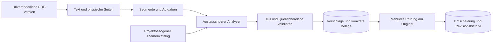

# Themen, Aufgaben und überprüfbare Verknüpfungen

Status: implementierter lokaler Backend-Prototyp. Er umfasst FastAPI, PostgreSQL,
PDF-Textextraktion und eine manuelle Prüfstrecke. Die vollständige Study-Oberfläche,
hybride Suche, Chat und Lernplanung sind nicht Teil dieses Vertikalschnitts.
Installation und Start stehen in [DEVELOPMENT](DEVELOPMENT.md).

## Komponenten und Datenfluss



- [Quellenpipeline](../apps/api/app/modules/sources/pipeline.py) orchestriert
  Extraktion, Segmentierung, Aufgabenerkennung, Analyzer und Ergebnisvalidierung.
- [Verträge](../apps/api/app/modules/sources/contracts.py) sind unveränderliche
  Python-Dataclasses. Ein Analyzer implementiert `version` und
  `analyze(segments, exercises, topics, source_type)`. Provider-SDKs sind dafür nicht nötig.
- [Anwendungsfälle](../apps/api/app/modules/knowledge/service.py) kontrollieren
  Projektzugriff, Dateiintegrität, Transaktionen, Wiederholung und Prüfentscheidungen.
- [Persistenzmodelle](../apps/api/app/infrastructure/models.py) speichern Topics,
  DocumentSegments, Exercises, TopicRelations, SourceLinks und LinkEvidence mit
  projektgebundenen Fremdschlüsseln und eindeutigen Identitäten.
- [HTTP-Routen](../apps/api/app/api/routes.py) delegieren an diese Anwendungsfälle.
  Eine eigene Browser-Anwendung existiert noch nicht; die FastAPI-OpenAPI-Oberfläche
  kann die Backend-Prüfstrecke bedienen.

## Bedeutung der Beziehungen

| Typ | Endpunkte und Richtung | Bedeutung und Grenze |
| --- | --- | --- |
| `IS_PREREQUISITE_OF` | Thema A → Thema B | A ist eine fachliche Voraussetzung für B. Nicht aus gemeinsamem Auftreten oder semantischer Ähnlichkeit ableiten. Ein Analysevorschlag braucht eine explizite Aussage als Grundlage und bleibt prüfpflichtig. |
| `EXPLAINS` | Dokumentsegment → Thema | Der Abschnitt erläutert das Konzept. Ein passendes Wort ist lediglich ein Vorschlagssignal und noch keine bestätigte Erklärung. |
| `APPLIES` | Aufgabe → Thema | Die Aufgabe verlangt die Anwendung des Konzepts. Der Default schlägt dies bei passenden Katalogbegriffen in Übungsblättern und Musterlösungen vor. |
| `EXAMINES` | Aufgabe → Thema | Die Klausuraufgabe prüft das Konzept. Auch diese Zuordnung benötigt fachliche Kontrolle. |
| `RELATED_TO` | Themenpaar oder Quelle → Thema | Thematischer Zusammenhang ohne behauptete Abhängigkeit. Themenpaare sind symmetrisch und werden nach UUID kanonisch gespeichert; SourceLinks behalten ihren Quelle-zu-Thema-Endpunkt. |

Eine TopicRelation verbindet zwei verschiedene Themen desselben Projekts.
Ein SourceLink hat genau einen Quellendpunkt: Segment oder Aufgabe, plus ein Thema.
Aufgaben können mehrere Segmente und Seiten umfassen. Ihre zugehörigen Segmente
stellen den zulässigen Belegbereich einer Aufgabenverknüpfung dar. Ein Beleg aus
einer anderen Aufgabe darf die Zuordnung nicht scheinbar begründen.

Die Software prüft die Form und Nachvollziehbarkeit einer Voraussetzung, nicht
deren allgemeine fachliche Wahrheit. Es gibt keine automatische transitive
Vervollständigung, keine Behauptung eines vollständigen Wissensgraphen und keinen
Lernplaner. Der lokale Analyzer erzeugt überhaupt keine Themenvoraussetzungen.

## Pipeline und Herkunft

1. **Einlesen:** Upload akzeptiert PDFs bis 16 MiB. Der Parser begrenzt die
   Seitenzahl auf 200 und den extrahierten Text einer Seite auf 200.000 Zeichen.
   Verschlüsselte oder strukturell unlesbare PDFs werden abgewiesen.
2. **Versionieren:** Originalbytes liegen im privaten Dateispeicher. Ein SHA-256
   identifiziert den Inhalt; Analyse und Download prüfen diesen Hash erneut.
   Derselbe Titel und Quellentyp bestimmen im Projekt das bestehende Dokument;
   andere Bytes erzeugen eine neue unveränderliche Version. Identische Bytes
   desselben Dokuments werden wiederverwendet.
3. **Extrahieren:** `pypdf` liefert Seitentexte. Eine Seite ohne Textschicht wird
   als `scan` mit `no_text_layer` und `ocr_required_or_blank` markiert. Das ist
   auch bei leeren oder rein grafischen Seiten möglich und kein Beweis für einen
   Scan. Fehler einzelner Seiten erzeugen `unreadable`/`extraction_failed`.
4. **Mathematik erhalten:** Extrahierte Zeichen werden nicht in neue Formeln
   umgeschrieben. Erkannte mathematische Darstellung erhält konservativ
   `mathematical_layout_unverified`; fehlende Glyphen oder verdächtige Steuerzeichen
   erzeugen weitere Warnungen. Eine fehlende Warnung garantiert keine korrekte Formel.
5. **Struktur erkennen:** Absätze und explizite Aufgabenüberschriften erzeugen
   deterministische Segmente. In Übungsblättern, Musterlösungen und Altklausuren
   werden Überschriften wie „Aufgabe 1“, „Aufgabe 2a“, „Exercise 3“ oder „Problem 4“
   erkannt. Text nach einer Überschrift gehört bis zur nächsten Aufgabe dazu,
   auch über Seiten hinweg. Es gibt keine allgemeine Layout- oder Teilaufgabenerkennung.
6. **Themen zuordnen:** Der lokale `CatalogueAnalyzer` sucht begrenzte, exakte
   Namens-/Aliasvorkommen aus dem angelegten Themenkatalog. Er erfindet keine
   unbekannten Themen. Wortvorkommen erzeugen prüfpflichtige Vorschläge, keine
   automatisch bestätigte wissenschaftliche Interpretation.
7. **Validieren und speichern:** Unbekannte IDs oder unzulässige Beziehungstypen
   werden abgewiesen. Ungültige Zitate oder nicht zum Quellendpunkt gehörende
   Belege werden entfernt und als fehlend/ungültig markiert. Auch ein Vorschlag
   ohne ausreichenden Beleg darf zur Kontrolle gespeichert werden; er ist dadurch
   nicht akzeptiert. Automatische Ergebnisse starten immer als `proposed`.

Physische Seiten sind **1-basiert**. Zeichenoffsets sind **0-basiert und halb-offen**
`[start_offset, end_offset)` und beziehen sich auf den unveränderten extrahierten
Text der jeweiligen Seite, gemessen in Python-Unicode-Codepunkten. Sie sind keine
PDF-Bytepositionen oder geometrischen Koordinaten. Segmenttext und Belegzitat müssen
exakt mit diesen Bereichen übereinstimmen. Ein Linkbeleg liefert Dokumenttitel,
Versions-ID, Originalhash, Seite, Segment und Zitat; der ursprüngliche PDF-Download
ermöglicht die unabhängige Kontrolle.

Druckseitenlabels, Kapitel und Gleichungsnummern werden noch nicht automatisch
ausgelesen. Die Aufgabennummer bleibt als im Text erkanntes Label erhalten.
Die sichtbare Übereinstimmung eines extrahierten Zitats mit dem Original muss ein
Mensch prüfen; reine Offsetprüfung ist keine solche Verifikation.

## Konfidenz und Prüfzustände

`score` ist optional. Der Default liefert keinen numerischen Wert
(`confidence_kind=none`). Andere Analyzer dürfen einen endlichen Wert zwischen 0
und 1 mit `confidence_kind=heuristic_uncalibrated` liefern. Er ist ein unkalibrierter
Indikator, **keine empirisch bestimmte Wahrscheinlichkeit**. Automatische Schwellen
zur fachlichen Freigabe sind nicht implementiert.

Zwei Zustände erfüllen unterschiedliche Aufgaben:

- `review_status`: `proposed`, `accepted` oder `rejected` bewertet die Verknüpfung.
- `evidence_status`: `extracted`, `uncertain` oder `manually_checked` bezeichnet
  die Prüfung der konkreten Fundstelle. Unsichere Extraktion wird nicht durch
  einen hohen Modellscore zuverlässig.

Akzeptieren verlangt mindestens einen gültigen Beleg und `evidence_checked=true`.
Der Prüfer muss vorher die Stelle im Original und ihre Stützung der Beziehung
kontrollieren. Der Server prüft Hash und Textbereich erneut, markiert die Belege
als manuell geprüft und schreibt eine ReviewDecision mit Akteur, Begründung,
Zeitpunkt und Revision. Der Boolean ist eine ausdrückliche menschliche Erklärung;
der Server kann nicht feststellen, ob das Original tatsächlich sorgfältig gelesen wurde.

Ablehnen benötigt keine positive Belegprüfung. Eine spätere Ablehnung löscht die
frühere Prüfung oder Historie nicht. Ein fehlender Beleg kann nicht allein durch
Bestätigung zu einer belegten Beziehung werden.

Korrigieren verändert Zielthema bzw. Beziehungstyp; bei TopicRelations können die
Themenendpunkte geändert werden. Der ursprüngliche Vorschlag wird `rejected`,
die Korrektur wird als eigener `proposed`-Datensatz mit Begründung und kopierten
Belegen angelegt. Die neue Bedeutung braucht eine erneute Prüfung und Annahme.
Unveränderte Korrekturen werden abgewiesen; eine bereits vorhandene Zielrelation
führt zu einem Konflikt statt einer doppelten Beziehung.

Prüf- und Korrekturanfragen enthalten `expected_revision`. Ein veralteter Stand
führt zu HTTP 409; vor einer erneuten Entscheidung muss die aktuelle Ansicht gelesen
werden. Projektgebundene Schreibvorgänge werden im Prototyp serialisiert.

## Wiederholung und Erhalt manueller Entscheidungen

Ein Analyse-Lauf ist durch Originalhash, Extraktorversion, Analyzerversion und
Konfigurationshash identifiziert. Der Themenkatalog, die Pipelineversion und
Konfigurationen gehören zu diesem Stand. Wiederholung desselben Laufs liefert
`reused=true`, statt Ergebnisse zu duplizieren. Eine geänderte Analyseversion oder
ein veränderter Katalog erzeugt einen neuen Lauf.

Identische Segmente, Aufgaben und semantische Linkendpunkte werden wiederverwendet.
Ein erneuter Analyzerlauf überschreibt weder die ursprüngliche Linkbegründung noch
eine Annahme, Ablehnung oder manuelle Korrektur. Ein automatisch erneut erkannter,
bereits abgelehnter Vorschlag bleibt abgelehnt. Ein neuer Lauf enthält seine
Ergebnis-IDs, die bestehenden Beziehungen behalten ihre ursprüngliche Herkunft.

Nur noch ungeprüfte Vorschläge dürfen zusätzliche gültige Belege erhalten; dabei
steigt die Revision. Automatische Belegergänzungen speichern ihren neuen Analyselauf,
manuelle ihren Akteur. Fehlende Belege lassen sich dadurch reparieren, ohne eine
bereits getroffene Entscheidung zu überschreiben. Themenrelationen und SourceLinks
behalten bei Korrekturen eine dauerhafte `corrected_from_id`-Herkunft.

Ändern sich durch einen neuen Extraktor Segmentgrenzen, Text oder Aufgabenanker,
können neue Segmente und neue Vorschläge entstehen. Alte Entscheidungen bleiben
erhalten, werden aber nicht automatisch auf diese neuen Fundstellen übertragen.
Dasselbe gilt für neue PDF-Versionen. Ein fachlich korrektes Zusammenführen solcher
Stände benötigt später einen expliziten Abgleich mit manueller Freigabe.

## Lokaler API-Ablauf

Der Prototyp verlangt `PHYSICS_LOCAL_MODE=1`, bindet lokal und verwendet eine feste
Entwickleridentität. Es gibt keine produktionsfähige Anmeldung. Keine öffentlichen
Deployments oder frei gewählten Identitätsheader verwenden. Start/Migrationen siehe
[DEVELOPMENT](DEVELOPMENT.md); API-Schema und Eingaben liegen unter den üblichen
FastAPI-Pfaden `/docs` und `/openapi.json`.

Beispiel mit `httpx` aus der Entwicklungsumgebung, ausgeführt in `apps/api`:

```sh
uv run python - /pfad/zum/kontrollierten-test.pdf <<'PY'
from pathlib import Path
import sys
import httpx

with httpx.Client(base_url="http://127.0.0.1:8000", timeout=60) as client:
    def checked(response):
        response.raise_for_status()
        return response.json()

    project = checked(client.post("/api/v1/projects", json={"title": "Mechanik-Test"}))
    prefix = f"/api/v1/projects/{project['id']}"
    checked(client.post(prefix + "/topics", json={
        "name": "Drehimpuls", "aliases": ["Angular momentum"]
    }))
    with Path(sys.argv[1]).open("rb") as document:
        upload = checked(client.post(prefix + "/documents", data={
            "title": "Kontrolliertes Uebungsblatt", "source_type": "exercise_sheet"
        }, files={"file": ("test.pdf", document, "application/pdf")}))
    version = f"{prefix}/document-versions/{upload['version_id']}"
    run = checked(client.post(version + "/analyses"))
    print("Lauf:", run["run_id"], "Warnungen:", run["issues"])
    print("Aufgaben:", checked(client.get(version + "/exercises")))
    print("Vorschlaege:", checked(client.get(prefix + "/links", params={"status": "proposed"})))
    print("Original zur Pruefung:", version + "/file")
PY
```

Ein Testdokument ohne Katalogbegriff erzeugt gegebenenfalls keine Links; das ist kein
Grund, Belege hinzuzuerfinden. Vor einer Review-Anfrage `/links/{link_id}` lesen,
den verlinkten Originalstand ansehen und die tatsächliche `revision` übernehmen.
Die JSON-Nutzlast für `POST /links/{link_id}/review` lautet beispielsweise:

```json
{
  "decision": "accept",
  "expected_revision": 1,
  "reason": "Originalstelle und fachliche Zuordnung manuell kontrolliert.",
  "evidence_checked": true
}
```

Für Ablehnung `decision=reject` verwenden. `POST /links/{link_id}/correction`
nimmt `expected_revision`, `reason` und beispielsweise die korrigierte `topic_id`
entgegen. Entsprechende Endpunkte existieren unter `/topic-relations`;
`POST /topic-relations` legt einen manuellen Themenbeziehungsvorschlag an,
optional mit konkreten `segment_id`-/Offset-/Zitatbelegen. Auch dieser benötigt
anschließend eine explizite Review. Listen unterstützen Statusfilter, `limit`
und `offset`.

`POST /links/{id}/evidence` bzw. `/topic-relations/{id}/evidence` ergänzt Belege
eines noch ungeprüften Vorschlags mit `expected_revision` und einer `evidence`-Liste
aus `segment_id`, `start_offset`, `end_offset` und `quote`. Quellenpositionen werden
erneut validiert. Beim erneuten `POST /topic-relations` mit neuen Belegen für bereits
existierende Endpunkte ist ebenfalls die aktuelle `expected_revision` erforderlich.

## Tests und nächste fachliche Daten

Die [Pipeline-Tests](../apps/api/tests/test_pipeline.py) verwenden kleine,
deterministisch erzeugte PDFs und austauschbare Test-Analyzer. Die Tests unter
[apps/api/tests](../apps/api/tests) prüfen außerdem Persistenz und API-Verhalten
gegen PostgreSQL; aktuelle Befehle und benötigte Testdatenbank stehen in
[DEVELOPMENT](DEVELOPMENT.md). Ausgeführte Tests und offene Grenzen müssen getrennt
berichtet werden; kein Testadapter weist die Qualität eines realen KI-Modells nach.

Für die nächste Phase werden benötigt:

- Rechtlich verwendbare, repräsentative Skripte, Übungsblätter und Altklausuren mit
  bekannten Aufgaben-/Teilaufgabengrenzen, Seiten und Lösungshintergründen.
- Mehrspaltige mathematische PDFs, Formeln mit Brüchen/Indizes/Matrizen und
  Fortsetzungen über Seiten hinweg, jeweils mit kontrollierter Transkription.
- Scans unterschiedlicher Qualität einschließlich absichtlich fehlerhafter OCR,
  mit menschlich geprüften Text-/Formelstellen und Layoutpositionen.
- Ein kuratierter Themen-/Alias-Katalog und fachliche Positiv-/Negativlabels für
  EXPLAINS/APPLIES/EXAMINES, bloße Verwandtschaft und echte Voraussetzungen.
- Festgelegte Qualitätsmaße, Trennung von Evaluations- und Trainingsbeispielen,
  Fehlerkosten und gegebenenfalls Kalibrationsdaten für Konfidenzindikatoren.

Offen bleiben verlässliche OCR, Layout-/Formelerkennung, automatische fachliche
Beziehungsbewertung, Abstimmung geänderter Extraktionsanker und Laufzeitisolation
für nicht vertrauenswürdige PDFs. Der synchrone lokale Parser hat Ressourcenlimits,
aber noch keine eigene Sandbox oder Hintergrundverarbeitung. Keine dieser Grenzen
wird durch ein vorhandenes Quellenzitat oder eine hohe Modellbewertung aufgehoben.
