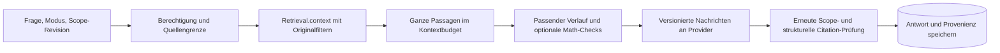

# Physiktutor: implementierter Backend-Kern

Status: lokale, quellengebundene Tutor-Orchestrierung mit austauschbaren Providern.
Der Standardprovider ist ein **deterministischer Mock**, kein fachlich leistungsfähiger
Physiktutor. Ein echter HTTPS-Adapter ist vorhanden; die wissenschaftliche Qualität
eines realen Modells wurde damit noch nicht nachgewiesen. Die manuellen Kriterien
stehen in [TUTOR_EVALUATION](TUTOR_EVALUATION.md).

Installation und Backendstart: [DEVELOPMENT](DEVELOPMENT.md).
Quellenauswahl und Fundstellen: [RETRIEVAL](RETRIEVAL.md).
Es gibt keine neue Chat-Weboberfläche und keine produktionsfähige Anmeldung.

## Komponenten und tatsächlicher Ablauf

- [Verträge](../apps/api/app/modules/tutor/contracts.py): Modus, Tiefe, strukturierte
  Nachrichten, Generierungsparameter und Antwortblöcke ohne Provider-SDK-Typen.
- [Orchestrierung](../apps/api/app/modules/tutor/service.py): Zugriffskontrolle,
  Retrieval, Kontext, Verlauf, Rechenprüfungen, Provideraufruf und Ergebnisprüfung.
- [Kontextauswahl](../apps/api/app/modules/tutor/context.py): begrenzte Pakete aus
  ganzen Passagen statt Abschneiden mitten in einer Formel.
- [Provider](../apps/api/app/modules/tutor/providers.py): lokaler Mock und
  HTTPS-Chat-Completions-Adapter mit validierter JSON-Ausgabe.
- [Mathematikwerkzeug](../apps/api/app/modules/tutor/mathematics.py): optionale,
  begrenzte symbolische Rechnungen in einem separaten Prozess.
- [Prompts](../apps/api/app/modules/tutor/prompts/__init__.py): versionierte Grund-,
  Modus- und Tiefenregeln; aktuelle Version `physics-tutor-v1`.
- [HTTP-Endpunkte](../apps/api/app/api/tutor.py): projektgebundene Eingaben und
  Ausgabe sowie Abruf des gespeicherten Gesprächsverlaufs.



1. Der Server prüft Projektzugriff, Scope, Revision und gegebenenfalls Modulfilter.
   `module_id` und `filters.module_id` müssen übereinstimmen. Eine Unterhaltung ist
   an genau einen Scope gebunden.
2. `retrieval_query` kann explizit angegeben werden. Andernfalls bildet der Service
   eine einfache Suchanfrage aus vorkommenden Themenkatalogbegriffen oder ausgewählten
   Fragewörtern. Das ist keine allgemeine physikalische Intent-Erkennung.
3. Die bestehende `RetrievalService.context` liefert ausschließlich erlaubte Passagen,
   Aufgaben und bestätigte Themenbezüge. Das Quellenmodul wird nicht dupliziert.
4. Ein Kontextpacker wählt ganze Passagen aus. Aufgaben-, Themen- und
   Voraussetzungshinweise werden nur mitgeführt, wenn ihre benötigten Belege im
   tatsächlich gepackten Kontext bleiben.
5. Der Service ergänzt passenden gespeicherten Verlauf, explizite Nutzerhinweise
   und gegebenenfalls beantragte mathematische Werkzeugresultate.
6. Der Provider erhält einen serverseitigen Systemprompt und ein strukturiertes
   User-Datenpaket. Quellen und Verläufe bleiben Daten und dürfen keine Quelle,
   Systemrolle oder Werkzeugberechtigung ändern.
7. Nach dem Provideraufruf werden Berechtigung, Scope-Revision, Citation-IDs und
   ursprüngliche Retrievalfilter erneut geprüft. Eine zwischenzeitliche Deaktivierung
   entwertet das Ergebnis vor der Ausgabe. Es gibt keine ungeprüfte Tokenstream-Ausgabe.
8. Antwort, konkrete Quellenbasis, Modus, Promptversion, Provider-/Modellkennung,
   Parameter, verfügbare Usage-Angaben und Qualitätsgrenzen werden gespeichert.

## Quellenkontrolle und Herkunft

Eine aktive Quelle ist keine Zustimmung zu externer KI-Verarbeitung. Für einen
externen Provider verlangt jede neue Anfrage zusätzlich
`allow_external_processing=true`. Ohne diesen expliziten Schalter erfolgt kein
Versand von Frage und Kontext an den externen Adapter. Quellenerweiterungen müssen
vorher unabhängig davon im Retrieval-Scope ausdrücklich bestätigt werden.
Eine externe Versandfreigabe darf eine inaktive Quelle nicht aktivieren.

Die Antwort hat getrennte Blöcke:

| `kind` | Bedeutung und technische Grenze |
| --- | --- |
| `source_content` | Als Quelleninhalt formulierte Aussage mit mindestens einer im gepackten Kontext enthaltenen Citation-ID. Der Server prüft die Adresse, nicht die semantische Stützung der Aussage. |
| `derivation` | Eigene, überprüfbar darzustellende Ableitung; übernommene Prämissen können Quellenreferenzen tragen. Die Kennzeichnung ist keine automatische Prüfung aller Rechenschritte. |
| `model_knowledge` | Ergänzendes Modellwissen, klar vom Quelleninhalt getrennt. In `SOURCE_MODE` wird dieser Blocktyp abgewiesen. |

`citation_integrity=verified` bestätigt die technische Auflösbarkeit unter dem
ursprünglichen Scope und seinen Filtern. Es bedeutet **keine semantisch verifizierte
Quellenaussage**. Daher tragen Blöcke `semantic_support=not_checked`; die Antwort
setzt `scientific_correctness_verified=false`. Insbesondere darf eine Oberfläche
`source_content` nicht allein deshalb als wissenschaftlich geprüft anzeigen.
Ein solcher Status benötigt später die eigenständige fachliche Prüfung.

Seitenzahlen und Quellenadressen werden aus den gespeicherten serverseitigen
Locators dargestellt. Der aktuelle Validator weist erkannte freie numerische
Seitenverweise im Modelltext ab; dieses Muster ist keine vollständige Erkennung
jeder möglichen Schreibweise einer erfundenen Quelle. Der Provider soll ausschließlich
Citation-IDs liefern und keine Seiten-, Gleichungs- oder Aufgabennummer erfinden.

Im `SOURCE_MODE` ruft der Service bei fehlenden oder wegen des Budgets vollständig
entfallenen Passagen den Provider nicht auf. Stattdessen erscheint eine lokale
Lückenmeldung mit `generation_invoked=false`. Andere Modi dürfen bei Quellenlücken
klar gekennzeichnetes Modellwissen liefern; die Quellenlücke bleibt sichtbar.
Keine der beiden Verhaltensweisen aktiviert zusätzliche Quellen.

## Vier Modi und Tiefe

| Modus | Beabsichtigtes Verhalten |
| --- | --- |
| `SOURCE_MODE` | Auf freigegebene Quellen beschränken; Eigenableitungen aus angegebenen Quellenprämissen kennzeichnen. Ohne Evidenz die konkrete Lücke nennen. |
| `DEEP_PHYSICS_MODE` | Relevante Annahmen, mathematische Voraussetzungen, Ansatz, Zwischenschritte, Einheiten, Randbedingungen und Interpretation ausführlich entwickeln. Das ist eine Promptregel, keine Kompetenzgarantie des Modells. |
| `EXAM_MODE` | Ansatzschritte und verfügbare Aufgabenbezüge nutzen. Keine Professorenschwerpunkte, Punktzahlen oder Prüfungswahrscheinlichkeiten erfinden. Kein Lernplaner. |
| `SOCRATIC_MODE` | Zunächst gezielte Fragen und Hinweise. `direct_answer=true` oder `full_solution=true` erlaubt ausdrücklich eine direkte Lösung; begrenzte eindeutige Sprachmuster werden ebenfalls berücksichtigt. |

`depth` ist `concise`, `standard` oder `deep`. Die Tiefe ändert die Promptanweisung,
nicht den Quellenzugriff. Ein Modell kann Anweisungen fachlich unzureichend erfüllen;
das wird durch die nachstehenden Evaluationen überprüft, nicht durch den Modusnamen.

## Kontextbudget und Gesprächsverlauf

`context_token_budget` begrenzt den Quellenkontext auf einen Wert zwischen 512 und
16.000. Der Packer zählt die UTF-8-Bytes seiner JSON-Repräsentation als konservativen
Token-Proxy (`utf8_bytes_conservative_proxy`, `exact_token_count=false`). Das ist
**keine genaue Zählung mit dem Tokenizer des gewählten Modells**. Zu große Passagen
werden vollständig ausgelassen und in `omitted_passages` sichtbar; sie werden nicht
in möglicherweise beschädigte Formelfragmente geschnitten.

Der Gesamtaufruf enthält zusätzlich Systemprompt, Frage, Verlauf und Math-Resultate.
Dessen `input_budget_estimate` wird gespeichert; das Quellenbudget ist keine
Garantie, dass ein beliebiges Modellkontextfenster ausreicht. Exakte
Tokenfensterplanung bleibt ein späterer Adapter-/Betriebsschritt.

Automatisch mitgeführter Verlauf stammt aus bis zu vier abgeschlossenen Turns
und muss zur aktuellen Scope-Revision, zu denselben Filtern, zum Modul und zum Modus passen.
Unpassende Turns werden nicht wieder als Modellkontext benutzt. Ihr historischer
Datensatz bleibt einsehbar. Bei Scopeänderungen ist Auslassen sicherer als eine
unbelegte Zusammenfassung alter Quelleninhalte.
Die ursprünglichen Blocktypen bleiben dabei erhalten; früheres Modellwissen aus
DEEP_PHYSICS_MODE wird nicht als untypisierte Antwort in SOURCE_MODE übernommen.

Einfache Quellenanweisungen am Fragenanfang werden ebenfalls serverseitig aufgelöst:
„Verwende nur Skript A; Erkläre Drehimpuls“ schränkt auf den exakten Dokumenttitel ein.
Ein inaktiver Titel oder ein Widerspruch zum strukturierten Quellenfilter erzeugt
einen Konflikt vor dem Modellaufruf. Das ist kein allgemeiner Sprachresolver;
komplexere Befehle müssen die strukturierten Retrieval-Filter verwenden.

Clientseitiges `history` akzeptiert höchstens acht Einträge mit `user` oder
`assistant`. Assistant-Einträge haben keine verlässliche Quellenprovenienz und
werden verworfen. User-Einträge bleiben ausdrücklich untrusted Zusatzdaten in der
User-Nachricht; sie werden nie zu Systemanweisungen erhoben. Auch eigener gespeicherter
Modelltext bleibt eine frühere Antwort und kein Nachweis fachlicher Wahrheit.

## Reproduzierbare API-Anfragen

Voraussetzung: PDFs importieren und analysieren, dann über die bestehende
Retrieval-API eine Auswahl aktivieren. Beispiele dafür stehen in [RETRIEVAL](RETRIEVAL.md).
`PROJECT_UUID`, `SCOPE_UUID` und `REVISION` unten sind durch reale Werte zu ersetzen.
Die folgenden vier JSON-Nutzlasten gehen jeweils an
`POST /api/v1/projects/PROJECT_UUID/tutor/answers`. Kein API-Schlüssel gehört in
Nutzlast oder Chat.

Quellengebundene Erklärung:

```json
{
  "question": "Welche Definition des Drehimpulses steht in meinen freigegebenen Quellen?",
  "mode": "SOURCE_MODE",
  "scope_id": "SCOPE_UUID",
  "scope_revision": 2,
  "depth": "standard",
  "retrieval_query": "Drehimpuls",
  "filters": {"source_instruction": "Verwende nur Skript A"}
}
```

Vertiefte Herleitung:

```json
{
  "question": "Leite die Bewegung des harmonischen Oszillators mit x(0)=x0 und v(0)=v0 her. Nenne Annahmen und Einheiten.",
  "mode": "DEEP_PHYSICS_MODE",
  "scope_id": "SCOPE_UUID",
  "scope_revision": 2,
  "depth": "deep",
  "retrieval_query": "harmonischer Oszillator",
  "context_token_budget": 6000,
  "allow_external_processing": false
}
```

Klausurbezogene Unterstützung anhand tatsächlich vorhandener Aufgaben:

```json
{
  "question": "Welche Ansatzschritte helfen bei den freigegebenen Drehimpulsaufgaben?",
  "mode": "EXAM_MODE",
  "scope_id": "SCOPE_UUID",
  "scope_revision": 2,
  "depth": "standard",
  "retrieval_query": "Drehimpuls",
  "filters": {"source_types": ["exercise_sheet", "past_exam"]}
}
```

Sokratischer Einstieg:

```json
{
  "question": "Ich möchte die Erhaltung des Drehimpulses begründen. Hilf mir mit einem ersten Hinweis.",
  "mode": "SOCRATIC_MODE",
  "scope_id": "SCOPE_UUID",
  "scope_revision": 2,
  "depth": "concise",
  "direct_answer": false,
  "retrieval_query": "Drehimpuls"
}
```

Die beispielhafte Revision `2` muss dem tatsächlichen Scope entsprechen. „Skript A“
muss der eindeutige Titel eines aktivierten Dokuments sein; andernfalls folgt ein
sichtbarer Konflikt. Für einen weiteren Turn `conversation_id` aus der Antwort
übernehmen. Für kontrollierte Wiederholung eine eigene UUID als `request_id` mitsenden:
Derselbe Schlüssel mit exakt demselben Inhalt verwendet das gespeicherte Ergebnis,
solange die Quellenrevision weiterhin gültig ist. Ein anderer Inhalt mit demselben
Schlüssel ist ein Konflikt. Ein bereits fehlgeschlagener oder laufender Schlüssel
startet keine zweite Generierung.

`GET /api/v1/projects/PROJECT_UUID/tutor/conversations/CONVERSATION_UUID` liefert
historische Turns einschließlich Status und Quellenstand. Die reine Anzeige alter
Antworten hebt eine aktuelle Deaktivierung nicht auf; erneute Generierung und
Wiederverwendung prüfen die aktuelle Auswahl.

## Providerkonfiguration

Der Standard `PHYSICS_LLM_PROVIDER=mock` ist lokal und benötigt kein Konto. Seine
Antworten sind ausdrücklich als Demonstration markiert; sie beweisen keine
Fähigkeit zur Lösung der Evaluationsaufgaben. Tests können einen eigenen
Deterministic-Provider über die App-Factory einsetzen.

| Einstellung | Verwendung |
| --- | --- |
| `PHYSICS_LLM_PROVIDER` | `mock` oder `openai_compatible`. |
| `PHYSICS_LLM_BASE_URL` | Serverseitige HTTPS-Basis-URL für Chat Completions; keine URL aus einer Nutzernachricht. |
| `PHYSICS_LLM_API_KEY` | Sichere Umgebungsbindung für den Adapter. Werte niemals protokollieren, in Dokumente schreiben oder im Chat eingeben. |
| `PHYSICS_LLM_MODEL` | Explizite Modellkennung für den echten Adapter; für Mock ist `mock-v1` voreingestellt. |

Ein echtes Modell wird nicht allein durch eine vorhandene Schlüsselbindung als
getestet betrachtet. Der Adapter verlangt HTTPS, folgt keinen Redirects, begrenzt
Antwortbytes, setzt Timeouts und validiert das vereinbarte JSON-Schema. Nicht jeder
Chat-Completions-kompatible Dienst unterstützt dessen strukturierten Ausgabeumfang.
Ein Wechsel braucht daher einen Adaptervertragstest und eine eigene Fachevaluation.
Im Anfragefeld `model` kann eine konfigurierte Modellkennung gewählt werden; der
API-Endpunkt oder ein Schlüssel lässt sich dort nicht ändern.

## Optionale mathematische Prüfungen

SymPy ist ein optionales Extra (`uv sync --frozen --extra math`), keine Voraussetzung
für Quellenantworten. Beantragt werden höchstens vier `math_checks` pro Turn:
`simplify`, `differentiate`, `integrate` oder `check_identity`.
Es sind explizite kleine algebraische Ausdrücke, keine beliebigen Python- oder
LaTeX-Programme. Eine begrenzte AST-Sprache erlaubt deklarierte reelle Variablen,
Grundrechenarten und einzelne freigegebene Funktionen. Es gibt kein `eval` und
keine Werkzeugausführung aus frei formuliertem Modelltext.

Beispiel eines zusätzlichen Feldes in einer Tutor-Anfrage:

```json
{
  "math_checks": [
    {
      "id": "d-quadrat",
      "operation": "differentiate",
      "expression": "x**2",
      "variables": ["x"],
      "variable": "x",
      "expected": "2*x",
      "assumptions": {"x": "real"}
    }
  ]
}
```

Jede Rechnung läuft in einem separaten, anschließend beendeten Prozess. Dessen
Start einschließlich SymPy-Import hat maximal fünf Sekunden; erst nach einem
validierten Ready-Handshake beginnt das weiterhin auf höchstens zwei Sekunden
begrenzte Rechenbudget. Der Abbau wartet höchstens zweimal eine halbe Sekunde,
mit Terminate und gegebenenfalls Kill. Start-/Rechenzeitüberschreitung und
Protokollabbruch liefern `inconclusive`, keine automatische Wiederholung.
Auf unterstützten Plattformen kommen CPU-/Speicherlimits hinzu; das ist keine
allgemeine Sandbox für fremde Programme.
Ein Werkzeugstatus unterscheidet:

- `tool_computed`: Ergebnis berechnet, ohne vorgegebenes Ergebnis zu bestätigen.
- `verified`: symbolische Gleichheit zum angegebenen Erwartungswert unter den
  protokollierten Bedingungen; kein Beweis der physikalischen Modellannahmen.
- `failed`: Rechnung oder behauptete Gleichheit scheitert im unterstützten Bereich.
- `inconclusive`: etwa Zeitlimit, nicht entschiedene Gleichheit oder unausgewertetes Integral.
- `unavailable`: optionales Werkzeug fehlt; es wurde nichts geprüft.
- `not_checked`: vertraglich verfügbarer Status für eine unterbliebene Prüfung.

Alle Resultate tragen `physics_proof=false`. Ein Modell darf nur tatsächlich
vorhandene `math_check_ids` referenzieren; daraus folgt nicht, dass jeder Satz,
jedes Vorzeichen oder jede Einheit seiner Antwort geprüft wäre. Modellseitige
`math_claims` bleiben `model_proposed`, keine automatisch bewiesenen Aussagen.

## Persistenz, Fehler und offene Grenzen

Die additive [Migration 0004](../apps/api/migrations/versions/0004_tutor_conversations.py)
führt `TutorConversation` und `TutorTurn` ein. Projekt-/Scopebezüge sind per
Fremdschlüssel geschützt. Pro Turn werden Frage, Modus, Tiefe, Revision, Originalfilter,
tatsächlich gepackte Auszüge, Generierungsparameter, Promptversion, Provider-/Modellname,
Antwort und Usage bzw. sicherer Fehlercode gespeichert. Die Datenbank enthält damit
auch verwendete Quellentexte; sie gehört zur privaten Dokumentenhaltung.

Ein Turn durchläuft `generating → completed | failed`. Während eines Provideraufrufs
wird die Projekttransaktion freigegeben. Der Quellenstand wird nach Math-Latenz,
unmittelbar vor dem Modellaufruf und vor Ausgabe erneut geprüft. Bereits gesendete
Daten können nicht zurückgerufen werden. Parallele Turns derselben Unterhaltung
werden abgewiesen. Bekannte Fehler
wie Provider-Timeout, Nichterreichbarkeit und ungültige Modellantworten werden mit
sicherer Meldung und Turn-ID protokolliert, ohne geheime Providerantworten zu speichern.
Ein Prozessabsturz kann jedoch einen Turn auf `generating` zurücklassen. Es gibt
noch keinen Lease-/Recovery-Worker oder eine automatische Wiederholung solcher
Turns; diese Betriebsgrenze ist vor längerem produktivem Einsatz zu beheben.

Der lokale Entwicklungsmodus ersetzt keine produktive Identitätsprüfung.
Nicht nachgewiesen sind die allgemeine mathematische Leistungsfähigkeit eines
realen Modells, eine semantische Belegprüfung jeder Aussage, OCR-/Formelqualität
beliebiger PDFs und exakte Tokenkosten. Die Fachabnahme benötigt die getrennte
Evaluation; ein grüner API-Test oder ein erfolgreicher Mock-Aufruf genügt dafür nicht.
