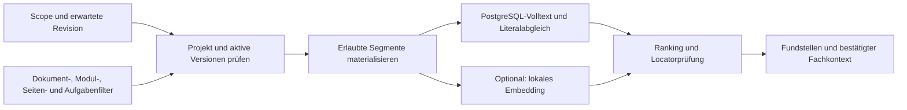

# Wissenschaftliche Retrieval- und Citation-Engine

Status: implementierter lokaler Backend-Schnitt, unabhängig von Antwortgenerierung.
Die [Architektur](../ARCHITECTURE.md) und die Regeln für
[Quellensteuerung](SOURCE_MANAGEMENT.md) bleiben maßgeblich. Authentifizierung und
PDF-Verarbeitung haben weiterhin die Grenzen des [Analyseprototyps](KNOWLEDGE_LINKING.md).

## Entscheidungen vor der Umsetzung

- Bestehende Originalversionen, DocumentSegments, Exercises und manuelle Entscheidungen
  bleiben maßgeblich. Es entsteht kein zweiter Extraktions- oder Belegbestand.
- Da noch keine Unterhaltung existiert, wird eine projektgebundene RetrievalScope als
  explizite Quellenauswahl verwendet. Ein späterer Chat kann darauf verweisen.
- Die Auswahl bindet konkrete Dokumentversionen und Analyseläufe. Neue Uploads oder
  Analysen verändern sie nicht stillschweigend. Suchanfragen dürfen nur einschränken.
- Fehlende oder inaktive ausdrücklich verlangte Quellen erzeugen einen Konflikt;
  eine leere Auswahl bedeutet niemals alle Quellen.
- Volltextsuche arbeitet ohne KI in PostgreSQL. Eine optionale lokale Embedding-
  Schnittstelle erhält ausschließlich bereits erlaubte, auflösbare Fundstellen.
  Keine externe Datenübertragung oder neue Modellabhängigkeit wurde eingeführt.
- Seiten-/Zeichenpositionen werden gegen gespeicherte unveränderte Seitentexte und
  Originalhash geprüft. Das bestätigt Auflösbarkeit, nicht wissenschaftliche
  Richtigkeit oder fehlerfreie PDF-Extraktion.
- Module erhalten nur eine projektgebundene Dokumentzuordnung; ein vollständiger
  Study-Workspace wird nicht vorgebaut. Kapitel werden nur aus tatsächlich erkannten
  Überschriften gespeichert, niemals aus räumlicher Nähe geraten.

## Komponenten und Suchgrenze

[ScopeService](../apps/api/app/modules/retrieval/scope.py) verwaltet Auswahl und
Modulzuordnung. [RetrievalService](../apps/api/app/modules/retrieval/service.py)
verwendet die unveränderlichen [Verträge](../apps/api/app/modules/retrieval/contracts.py).
Die [API](../apps/api/app/api/retrieval.py) prüft HTTP-Eingaben und delegiert.



Jede Quellenaktivierung benötigt eine bereits analysierte Originalversion.
Die Auswahl pinnt beim ersten Hinzufügen deren neuesten Analyselauf; unveränderte
Versionen behalten ihren Pin auch bei erneutem Speichern der Auswahl. Ein bewusstes
Entfernen/erneutes Aktivieren oder eine neue Auswahl übernimmt einen neueren Lauf.
Eine Auswahl beginnt leer. Hinzunahmen benötigen `confirmed=true`; reine Reduktionen
nicht. Auswahländerungen und Suchanfragen prüfen Revision und Projektberechtigung.
Ein Projektlock serialisiert Änderungen und laufende Recherche im lokalen Prototyp.

Vor Textmatching und Ranking entsteht ein PostgreSQL-`MATERIALIZED`-CTE ausschließlich
mit den erlaubten Segmenten. Damit gibt es kein globales Top-k mit nachträglichem
Aussortieren. Volltext nutzt `to_tsvector('simple', ...)` und `websearch_to_tsquery`;
ein zusätzlicher Literalabgleich erhält Suchbarkeit von LaTeX-/Formelfragmenten.
Sortierung erfolgt nach Rang und stabilen Positions-/ID-Schlüsseln. Mehrere Vorkommen
im selben Segment erzeugen keinen doppelten Treffer. Scores sind Rangsignale,
keine Wahrscheinlichkeiten oder fachlichen Qualitätsurteile.

Die Volltextkonfiguration bietet keine allgemeine deutsche Lemmatisierung,
Begriffsontologie oder symbolische Formelgleichheit. Eine Frage wird nicht automatisch
in wissenschaftliche Teilfragen zerlegt. Knappe Suchbegriffe und explizite Filter
sind der reproduzierbare Ausgangspunkt. GIN-/ANN-Indizes und Hintergrundjobs wurden
für diesen begrenzten lokalen Schnitt nicht vorgebaut; große Korpora benötigen
gezielte Laufzeitmessung und weitere Optimierung.

## API-Vertrag

Alle folgenden Pfade liegen unter `/api/v1/projects/{project_id}`.
Listen von Quellen-IDs sind explizite Filter, keine Aktivierungsanweisungen.

| Methode / Pfad | Eingabe und Wirkung |
| --- | --- |
| POST /modules | `{title}` legt ein Modul an. |
| GET /modules | Listet projektgebundene Module. |
| PUT /modules/{module_id}/documents/{document_id} | Ordnet eine bestehende Quelle idempotent zu. |
| POST /retrieval/scopes | `{name}` erzeugt eine leere Auswahl mit Revision 1. |
| GET /retrieval/scopes/{scope_id} | Liefert Revision und konkrete Versions-/Analyse-Pins. |
| PUT /retrieval/scopes/{scope_id}/sources | `{expected_revision, document_version_ids, confirmed}` ersetzt die Auswahl; maximal 50 Versionen. |
| POST /retrieval/search | Liefert relevante Fundstellen mit Herkunft und Qualitätsinformationen. |
| POST /retrieval/context | Liefert dieselben Fundstellen und gruppierten Tutor-Kontext, ohne Sprachmodellgenerierung. |
| POST /retrieval/citations/verify | `{scope_id, scope_revision, segment_id, filters}` prüft einen Locator unter den ursprünglichen Suchfiltern. |
| GET /retrieval/scopes/{scope_id}/citations/{segment_id}?scope_revision=N | Manuelle Auflösung innerhalb der gesamten aktiven Auswahl; keine Bestätigung engerer früherer Suchfilter. |

Beispiel für eine Recherche:

```json
{
  "scope_id": "00000000-0000-0000-0000-000000000001",
  "scope_revision": 2,
  "query": "Drehimpuls",
  "k": 3,
  "mode": "lexical",
  "filters": {
    "source_instruction": "Verwende nur Skript A",
    "page_start": 1,
    "page_end": 3
  }
}
```

Die Beispiel-ID muss durch die tatsächlich erzeugte Auswahl-ID ersetzt werden.
`query` ist erforderlich (1–1000 Zeichen), `k` liegt zwischen 1 und 50.
`mode` ist `lexical` (Standard), `semantic` oder `hybrid`.
Optionale Filter:

- `document_ids`, `document_version_ids`: konkrete, bereits aktive Quellen;
- `module_id`, `source_types`: Einschränkung auf passende aktive Dokumente;
- `page_start`, `page_end`: inklusive physische PDF-Seiten, 1-basiert;
- `exercise_label`: genaues erkanntes Aufgabenlabel, etwa `2a`;
- `chapter`: genaues gespeichertes Kapitel-/Abschnittslabel;
- `source_instruction`: begrenzte Syntax „nur <exakter Titel>“, optional mit
  „Verwende“, „Benutze“ oder „Nutze“, alternativ „ausschließlich“.

Der Titelresolver rät nicht bei mehrdeutigen Namen und aktiviert nichts.
Komplexe natürliche Quellenanweisungen und Vergleiche sind noch kein allgemeiner
Chatresolver. Strukturierte IDs unterstützen mehrere ausgewählte Quellen.
Eine ausdrückliche inaktive Dokument-/Versions-ID erzeugt auch dann einen Konflikt,
wenn sie keine Suchtreffer hätte. Widersprüchliche Dokument-/Versionsfilter werden
nicht still als leeres Resultat behandelt.

Kapitelmetadata entsteht bei neuen Skript-/Lehrbuch-/Paper-Segmenten nur aus deren
wörtlicher Anfangsüberschrift, z. B. „Kapitel 2.1“ oder „2.1 Drehimpuls“. Keine
Vererbung auf folgende Absätze und kein geratenes Backfill bestehender Segmente.
Nicht bekannte Kapitel liefern keine Treffer und einen Metadatahinweis.

## Antwort und präzise Fundstellen

Das Antwortschema trägt `schema_version="retrieval.v1"`. Es enthält Auswahl-ID,
Revision, Anfrage, Modus, `effective_sources`, `hits` und `warnings`.
Ein Treffer enthält:

- `citation_id`/`segment_id`, Dokument-ID/-Titel/-Typ, Versions-ID und SHA-256;
- gepinnten Analyselauf und Extraktorversion;
- `page_number`, `start_offset`, `end_offset` und unveränderten `original_text`;
- `chapter` nur bei vorhandener Angabe, Aufgaben mit erkanntem Original-Label;
- bestätigte Themen-/Voraussetzungsbeziehungen mit ihren kontrollierten Belegen;
- Extraktionswarnungen, `extraction_uncertain` und einen Rangscore.

Offsets sind halb-offene Unicode-Codepunktpositionen `[start, end)` im gespeicherten
unveränderten Seitentext, keine PDF-Bytepositionen. Bei der Prüfung müssen Seite,
Bereich und Text exakt übereinstimmen. Originaldateien müssen vorhanden sein und
ihren gespeicherten Hash erfüllen. Ungültige Suchstellen werden ausgeschlossen und
als Warnung gemeldet; eine gezielte ungültige Locatoranfrage liefert einen Konflikt.

`locator_verified=true` bedeutet ausschließlich
`verification_scope="stored_extraction_and_original_hash"`.
`scientific_verification=false` bleibt ausdrücklich bestehen: korrekte Adresse und
Hash beweisen weder fehlerfreie Textextraktion noch eine physikalische Aussage.
Keine Gleichungsnummer, Kapitelangabe oder Seitenzahl wird vom Modell ergänzt.
Die bestehenden Unsicherheitsmarker für Scans, Glyphen und Mathematik bleiben sichtbar.
Keine Treffer bedeutet „in dieser Suche nicht gefunden“, nicht „inhaltlich widerlegt“.

## Tutor-Schnittstelle und optionale Semantik

`context` liefert zusätzlich `tutor_context` mit `passages`, `exercises`,
`exam_exercises`, `topics` und `prerequisites`. Themenzuordnungen und Voraussetzungen
werden nur bei `accepted`-Verknüpfungen mit passenden `manually_checked`-Belegen
innerhalb derselben effektiven Filtermenge geliefert. Abgelehnte oder korrigierte
Originalzuordnungen bleiben ausgeschlossen. Aufgabenlabels sind dagegen als
`extracted` gekennzeichnet; eine Teilmenge einer mehrseitigen Aufgabe trägt `partial`.

`citation_constraints` enthält Auswahl-ID, Revision und die ursprünglichen Filter.
Ein zukünftiger Tutor muss diese unverändert an `POST /retrieval/citations/verify`
weitergeben. Der breitere manuelle GET-Endpunkt ist kein Ersatz für diese Prüfung.
Bei einer späteren Auswahländerung wird die alte Revision abgewiesen. Es werden
keine generierten Antworten, alten Chatkontexte oder Such-Caches verarbeitet.

`EmbeddingProvider` verlangt `model_id`, `is_local=True` und `embed(texts)`.
Ohne konfigurierten Provider liefern angefragte semantische Modi HTTP 501; kein
stiller Ersatz durch angebliche semantische Ergebnisse. Der optionale Adapter
berechnet exakte Kosinusähnlichkeit über höchstens 2000 vorgefilterte, gültige
Segmente. Externe Adapter werden abgewiesen. Dimensionen und endliche, nichtleere
Vektoren werden geprüft. `hybrid` kombiniert Ranglisten per Reciprocal Rank Fusion.
Es ist kein reales Embeddingmodell installiert und kein semantischer Qualitätsgewinn
nachgewiesen. Für die spätere große Vektorsuche bleibt ein anderer Adapter möglich.

## Fehlerfälle

| Status / Code | Bedeutung |
| --- | --- |
| 404 / not_found | Projekt, Modul oder Auswahl nicht berechtigt/verfügbar. |
| 409 / source_conflict | Ausdrücklich verlangte Quelle inaktiv, Titel unbekannt/mehrdeutig, widersprüchlicher Filter oder Citation außerhalb des effektiven Bereichs. |
| 409 / source_confirmation_required | Zusätzliche Quelle noch nicht ausdrücklich bestätigt. |
| 409 / scope_revision_conflict | Auswahl wurde inzwischen geändert. |
| 409 / source_unavailable, file_unavailable, hash_mismatch | Quelle nicht analysiert oder gespeicherter Stand nicht verwendbar. |
| 409 / citation_invalid, citation_unavailable | Gespeicherte Position nicht auflösbar. |
| 409 / external_processing_disabled | Nichtlokaler Embeddingadapter ist nicht zugelassen. |
| 422 | Ungültige Eingaben, nicht unterstützte Quellenanweisung oder ungültige/zu große Embeddingkandidatenmenge. |
| 501 / semantic_unavailable | Semantik angefragt, aber kein Provider vorhanden. |
| 503 / embedding_unavailable | Lokaler Provider ausgefallen. |

Keine Treffer sind ein erfolgreicher Suchlauf mit `hits=[]` und Warnungen, kein
Anlass zum Zugriff auf weitere Quellen.

## Reproduzierbarer Durchlauf und Evaluation

Installation, Migrationen und Serverstart: [DEVELOPMENT](DEVELOPMENT.md).
Mit laufender API im Verzeichnis `apps/api`:

```sh
uv run --frozen python scripts/retrieval_demo.py
```

Das [ausführbare Beispiel](../apps/api/scripts/retrieval_demo.py) erzeugt ausdrücklich
synthetische PDFs, importiert und analysiert sie, aktiviert nur Skript A, sucht,
verifiziert den Locator gegen den tatsächlichen PDF-Text und prüft den Konflikt bei
Skript B. Pro Lauf entsteht ein neues Testprojekt; bestehende Daten werden nicht gelöscht.

Der [Evaluationsdatensatz](../apps/api/tests/fixtures/retrieval_evaluation.json)
besteht aus drei synthetischen Dokumenten mit sieben Seiten, vier Fragen samt
expliziten Suchbegriffen und acht erwarteten Dokument-/Seitenstellen. Er enthält
keine verifizierte wissenschaftliche Literatur. Die
[Retrievaltests](../apps/api/tests/test_retrieval.py) messen Recall@3 pro Anfrage und
prüfen jede zurückgegebene Position gegen das bekannte Original sowie die API-Auflösung.

Gemessen: Macro Recall@3 **1,0**, exakte Fundstellenwiedergewinnung **8/8**.
Das ist ausschließlich ein Ergebnis für diese kleinen kontrollierten Termpositionen,
keine Evaluation freier Fragen, realer Mathematik-PDFs, OCR oder physikalischer Wahrheit.
Vor einem Tutor werden ein repräsentatives, rechtlich nutzbares Korpus, fachliche
Relevanzlabels, kontrollierte Formeltranskriptionen, Negativbeispiele und getrennte
Evaluationsdaten benötigt. Produktive Identität, PDF-Sandboxing, Skalierung und
fachliche Antwort-/Stützungsprüfung bleiben zusätzliche Aufgaben.
